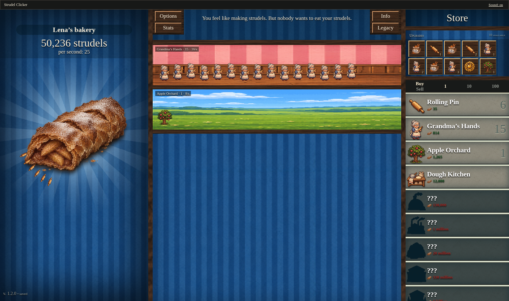

# Strudel Clicker

A playable, classic browser idle game about a thoroughly unreasonable apple-strudel business. Blue paper wallpaper, dark wooden trim, a semi-realistic pastry and detailed pixel building sprites, and three columns inspired by the early browser-clicker era.



## Run

Node.js 20 or newer (validated with Node 24). No framework, build step, runtime dependencies, credentials, or external asset requests.

```sh
npm ci
npm start
```

The server listens on `0.0.0.0` and uses `PORT`, defaulting to `3000`. Open your local server in a browser. Save data belongs to that browser and origin; use Options → Export save to transfer it to another device or deployment.

## What is included

- Click-to-bake with pooled floating numbers, capped crumb particles, pastry press feedback, synthesized Web Audio, volume and mute controls.
- 13 buildings, from Rolling Pin and Grandma’s Hands to Portal to Vienna, an Austrian Time Machine, and Cosmic Bakery. Geometric 15% pricing, buy/sell, 1/10/100 batches, contribution tooltips, and building scene strips.
- 174 upgrades: 156 building milestones, ten click upgrades, eight global recipes. Available upgrades are sorted by price, cheapest first.
- 26 achievements, unlock notifications, and a Butter bonus for building production. Base clicks remain exactly +1 until a click upgrade is bought.
- Random golden strudels: instant rewards, 12-second ×7 production, or 13-second ×77 click power; visible buff timers.
- Ascension, Vienna Points, and four permanent legacy recipes. The first point unlocks at one billion lifetime strudels; future points follow the square-root formula shown in Legacy.
- Statistics, renameable bakery, rotating news, Options and Info pages, named/scientific numbers, autosave every 60 seconds and on page exit, save/load/export/import, and up to 24 hours of offline production.
- First-run name and English/German language selection, localized menus and tooltips, named bakeries, and persistent language preferences.
- Grandma sprites have stable names and ages from 81 to 120, shown on hover or keyboard focus.
- Rolling pins orbit the main pastry instead of occupying a scene row; the light burst is larger.
- All resource displays round down to whole numbers. Fractional production accumulates separately until a whole strudel is baked. The full integer bank counter updates every animation frame; the store and other expensive UI updates remain throttled. Very high production can exceed the display refresh rate.
- Responsive stacked phone layout and reduced-motion support.
- Original image-generated assets. The main strudel keeps its semi-realistic finish; store, upgrade, achievement, and scene icons use detailed pixel artwork. Scene backgrounds are distinct empty environments, with one separate sprite per owned building. Backgrounds and sprites are preloaded, and large collections scroll without the old 14-object cap.

## Deploy to the existing Render web service

Update **`strudel-clicker-web`** rather than creating another service or using the unwanted static site.

| Setting           | Value                                   |
| ----------------- | --------------------------------------- |
| Repository        | `strydomadam321-dotcom/strudel-clicker` |
| Branch            | `main`                                  |
| Runtime           | Node                                    |
| Root directory    | repository root (blank)                 |
| Build command     | `npm install`                           |
| Start command     | `npm start`                             |
| Health check path | `/`                                     |
| Auto-deploy       | enabled for `main`                      |

No environment variables are required. Render injects `PORT`. A web service is required because `server.js` serves the app. Render deployment and the existing static site's removal are left to the owner, as requested. No live deployment is claimed by this repository.

## Validation

```sh
npm test
```

Sixteen Node tests cover pricing, purchases and refunds, requirements and multipliers, offline caps, all golden rewards and expiry, prestige persistence, save validation/Unicode round-trip, and all building milestone upgrades.

An additional Chromium browser smoke test runs against an already-running local server. Install Playwright separately, then make it available through `PLAYWRIGHT_MODULE` (an absolute module directory) or Node's module resolution:

```sh
PLAYWRIGHT_MODULE=/path/to/playwright node tests/browser.cjs
PLAYWRIGHT_MODULE=/path/to/playwright node tests/features.browser.cjs
```

It exercises click/buy/sell, upgrades, save/reload, export/import, late-game ascension and permanent upgrades using a valid imported fixture, lucky spawning/catching and autosave using browser time control, image/HTTP/console checks, phone overflow, one-per-purchase scene counts beyond the former cap, and cold-load artwork/trim synchronization. The feature suite also covers both onboarding languages, persistent profiles, grandma identity, upgrade ordering, orbit rendering, individual counter steps, integer displays, and the 12-second buff expiry. Screenshots are written to ignored `test-results/`. Late-game browser checks use seeded saves rather than claiming a multi-day balance playthrough. Chromium was tested; Safari/Firefox and physical-device audio have not been tested.

## Files

```text
strudel-clicker/
├── index.html              # three-column game shell
├── style.css               # classic desktop and phone presentation
├── game.js                 # economy, buffs, upgrades, prestige
├── scenes.js               # preloading and one-per-purchase scene sprites
├── orbit.js                # rolling pins around the pastry
├── grandmas.js             # stable grandma names and ages
├── numbers.js              # integer number formatting
├── i18n.js                 # English/German UI translation
├── ui.js                   # rendering, input, audio, particles, screens
├── save.js                 # local storage, validation, import/export
├── server.js               # dependency-free Node HTTP server
├── package.json
├── package-lock.json
├── data/
│   ├── buildings.js
│   ├── upgrades.js
│   └── achievements.js
├── assets/                 # optimized generated PNG sprites and textures
│   ├── strudel.png / strudel-small.png
│   ├── [building].png / [building]-silhouette.png
│   ├── scene-[building].png
│   ├── cinnamon.png / medal.png / lucky.png
│   └── blue.png / wood.png / button.png / parchment.png
├── tests/
│   ├── game.test.js
│   ├── numbers.test.js
│   ├── browser.cjs
│   └── features.browser.cjs
└── docs/
    └── screenshot.png
```

Next improvements: extended progression balancing from real play sessions, more individual achievement emblems and tier-specific upgrade art, and accessibility testing with screen readers. There is no server-side account or cloud-save system; exports are the portable backup.
